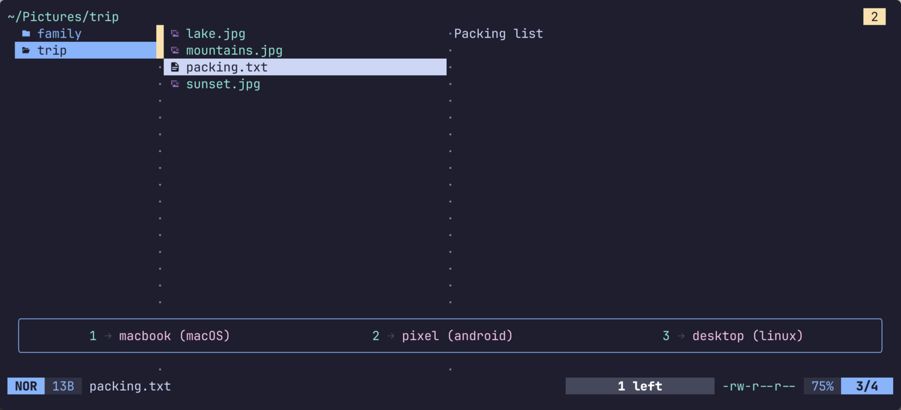

# tailscale.yazi

> Taildrop in Yazi: send the selected files to a device of your tailnet, and take the files that other devices sent.

[](https://github.com/yazi-contrib/tailscale.yazi/actions/workflows/ci.yml) [](https://github.com/yazi-contrib/tailscale.yazi/releases) [](LICENSE)



## Dependencies

- [Yazi](https://yazi-rs.github.io) (the latest release)
- [Tailscale](https://tailscale.com) - the `tailscale` command, signed in to a tailnet
- [jq](https://jqlang.github.io/jq/) - to read the list of devices that `tailscale status --json` gives
- [zip](https://infozip.sourceforge.net) - only to send a folder, which Taildrop takes as a zip

## Installation

```sh
ya pkg add yazi-contrib/tailscale
```

Or by hand, into the folder of your configuration of Yazi:

```sh
git clone https://github.com/yazi-contrib/tailscale.yazi ~/.config/yazi/plugins/tailscale.yazi
```

## Usage

Bind keys in `keymap.toml`:

```toml
[mgr]
prepend_keymap = [
  { on = ["T", "s"], run = "plugin tailscale send", desc = "Send with Taildrop" },
  { on = ["T", "r"], run = "plugin tailscale receive", desc = "Receive with Taildrop" },
]
```

### Send

`plugin tailscale send` sends the files that are selected in Yazi, or the one that is hovered when none is
selected. A menu lists the devices that are **online**, with a key for each: the others cannot take a file.
Pick one, and each file is sent with `tailscale file cp`. The result is a notification: how many files were sent,
and for each one that was not, why. `Esc` cancels, and nothing is sent.

A folder is sent as a zip, which is what Taildrop takes. With `zip_folders = false`, folders are skipped.

### Receive

`plugin tailscale receive` takes the files that are waiting in the Taildrop inbox with
`tailscale file get --conflict=rename`, into the folder that Yazi shows, or into `receive_dir`. A file with a
name that is there already gets another name.

## Configuration

Optionally, in `init.lua`:

```lua
require("tailscale"):setup {
  receive_dir = "~/Downloads",
  zip_folders = true,
}
```

| Option        | Default                  | Meaning                                                       |
|---------------|--------------------------|---------------------------------------------------------------|
| `receive_dir` | the folder of Yazi       | Where `receive` puts the files                                |
| `zip_folders` | `true`                   | Send a folder as a zip. `false` skips the folders             |

On Linux, the files stay in the inbox of `tailscaled` until `tailscale file get` takes them, and only root and
the operator can. Run `sudo tailscale set --operator=$USER` once, so that your user can.

## How it works, and what can break

The plugin runs `tailscale status --json` through `jq` for the devices, `tailscale file cp FILE DEVICE:` for each
file, and `tailscale file get` for the inbox. The menu is the one of Yazi (`ya.which`), so it needs no other tool.
The options of `setup` are read through `ya.sync`, as the code that runs async has a Lua state of its own.

The selected files of Yazi are file objects in the latest release and were urls before, and the plugin reads both.
A new release of Yazi can change what the plugin uses, so the tests run with the latest Yazi in CI.

## Development

```sh
nix develop
bats tests/
```

The tests start Yazi in a detached tmux session with a configuration of its own that loads the plugin from this
folder, and put a `tailscale` that is a script first in the `PATH`. It prints a list of devices, and writes down
what it is asked to do. The tests check the calls, so nothing goes on a network. That the real `tailscale` accepts
the calls is not in the tests.

## The yazi-contrib ecosystem

Plugins of Yazi, one repository for each: `viewer.yazi`, `layout.yazi`, `starship.yazi`, `finder.yazi`,
`tailscale.yazi`.

## License

MIT
